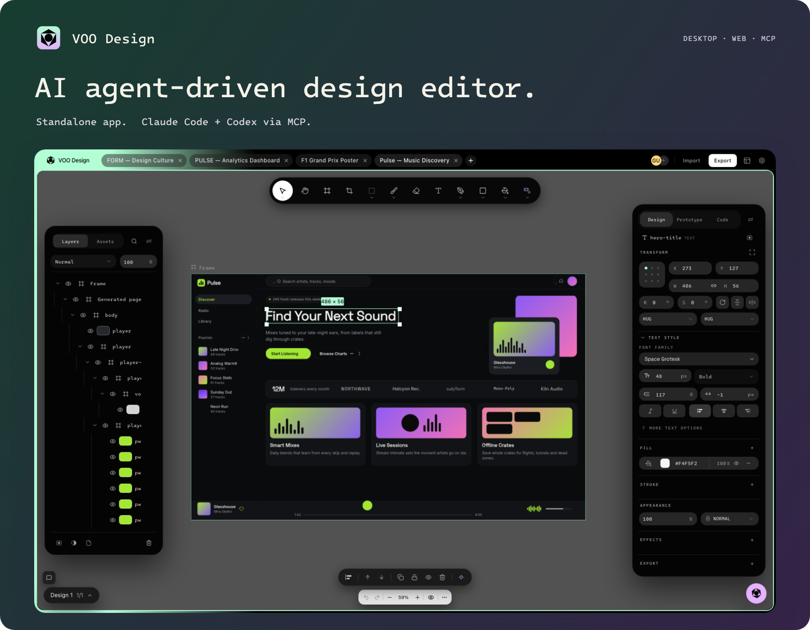
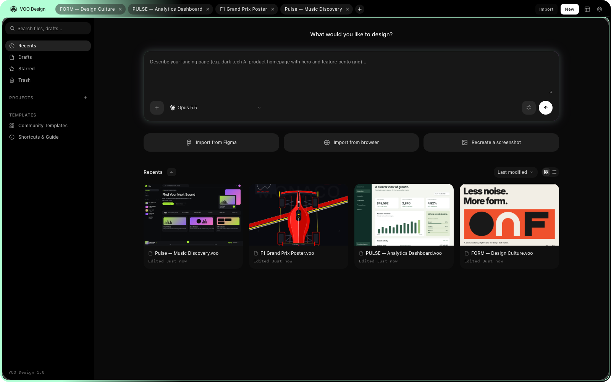
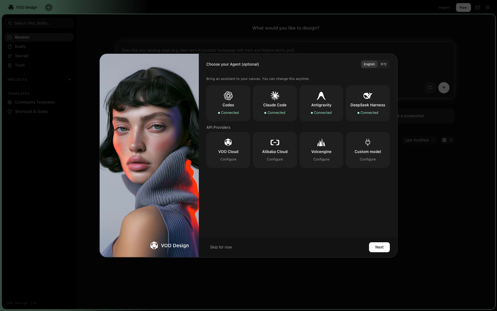
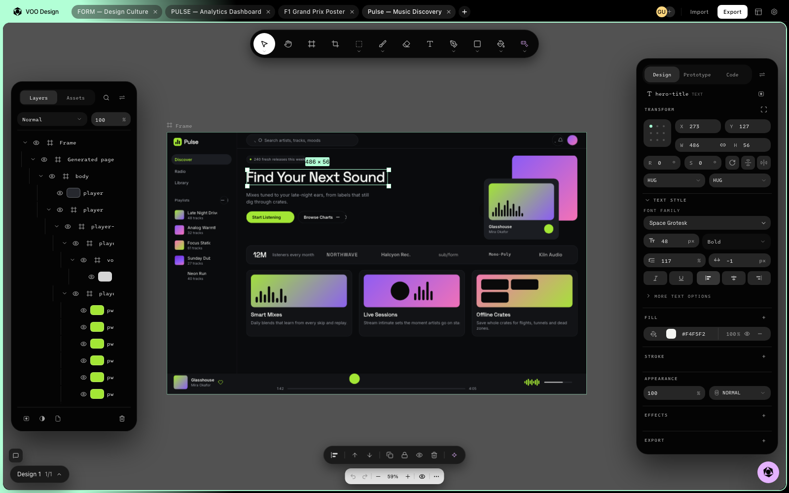
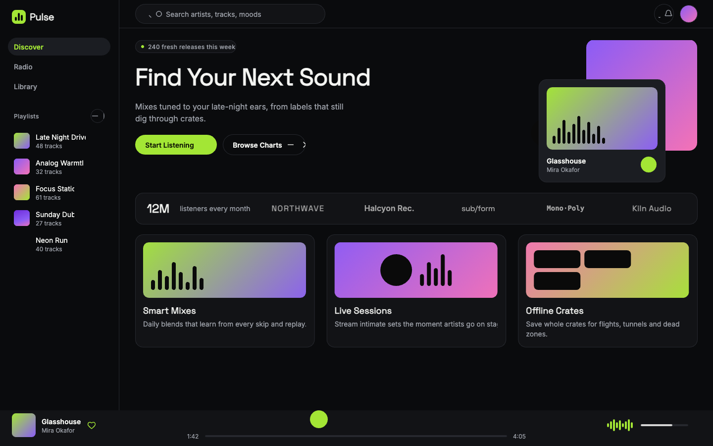
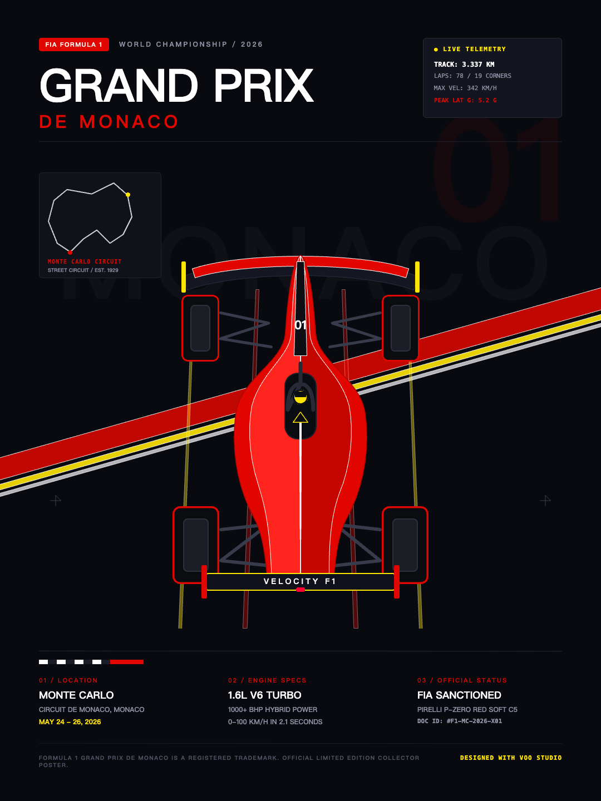
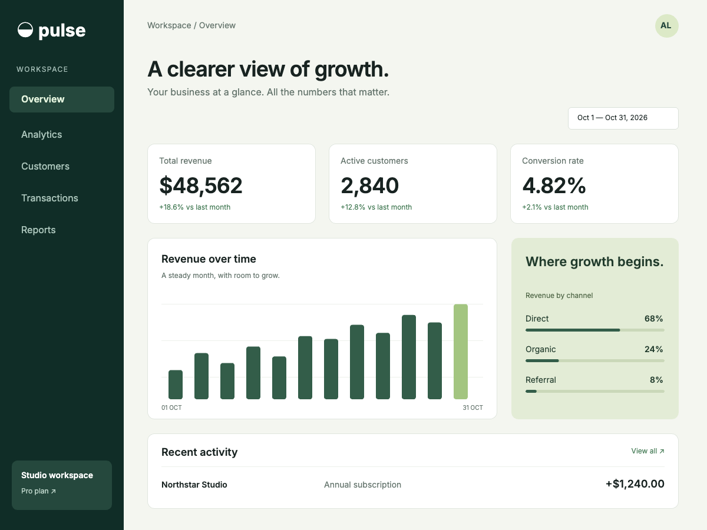
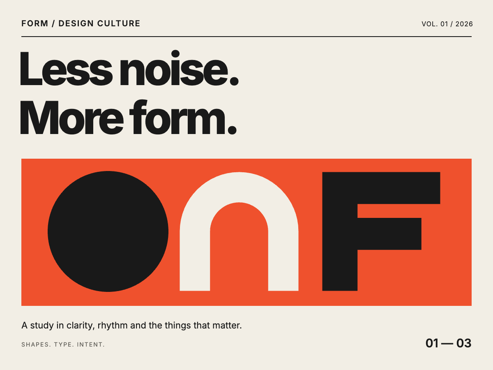

<p align="center">
  <a href="https://voo.run/editor/">Open the editor</a> ·
  <a href="#connect-your-agent">Connect your agent</a> ·
  <a href="docs/examples/README.md">Explore the examples</a>
</p>

**AI agent-driven design editor.** Use VOO as an independent app, or let Claude Code and Codex operate the same editable canvas through MCP.

## Design your way

| Standalone app | Claude Code / Codex |
| --- | --- |
| Design directly in the desktop app or web editor, with an optional in-app Agent. | Connect the Claude Code plugin or Codex MCP connector to inspect, create and edit a live canvas. |

- **Vector, image and layout.** Combine paths, text, images, masks and Auto Layout in one document.
- **Real edits, shared control.** Agent changes remain editable layers, with the same undo history as hands-on work.
- **Keep your work.** Save portable `.voo` files and export images or handoff code.

## Product tour

### Workspace

Start a design, import work and return to recent projects.



### Guided setup

Choose an agent or model provider during optional first-run setup.



### Edit on the canvas

The music design is open with its headline selected, alongside the layer tree and text inspector.



## Made with VOO

Interfaces, posters and brand graphics. [Download the editable source files](docs/examples/README.md).

| Music discovery | F1 · Racing poster |
| --- | --- |
|  |  |
| [Music interface](docs/examples/music-discovery.voo) | [Racing poster](docs/examples/f1-grand-prix.voo) |

| PULSE · Dashboard | FORM · Typography |
| --- | --- |
|  |  |
| [Dashboard](docs/examples/pulse-dashboard.voo) | [Typography poster](docs/examples/form-poster.voo) |

These are visual design examples with editable text, shapes and layer structure. Their controls do not implement running applications.

## Connect your agent

Keep VOO open as the canvas host. The plugin connects your agent to that live document through MCP.

<details>
<summary>Claude Code plugin and Codex MCP setup</summary>

Build the portable connector into a new folder:

```bash
export VOO_PLUGIN_DIR=/absolute/new/voo-plugin
node scripts/build-agent-plugin.mjs "$VOO_PLUGIN_DIR"
```

**Claude Code plugin**

```bash
claude --plugin-dir "$VOO_PLUGIN_DIR"
```

**Codex through MCP**

```bash
codex mcp add voo -- node "$VOO_PLUGIN_DIR/scripts/mcp-server.mjs"
```

For the web editor, also run `npm run bridge`. Ask your agent to inspect the canvas or create a design. Requirements and details: [plugin guide](plugins/voo/README.md) · [MCP setup](docs/mcp-server.md).

</details>

<details>
<summary>Feature reference and development</summary>

## Features

### Editing
- **Vector and pixel layers**: rectangles, ellipses, paths drawn with the pen tool, text, images, groups and boolean operations.
- **Selection tools**: marquee, lasso and magnetic lasso, with snapping, equal-gap distribution and alignment.
- **Pixel tools**: brush, eraser, paint and mask editing, with undo and redo. Brush stamps can be imported from Photoshop `.abr` files.
- **Transforms**: free transform, mesh transform and puppet warp.
- **Non-destructive adjustments**: adjustment layers and blend modes.
- **Text on path** and **auto layout**, including layout constraints resolved on import.
- **Find and replace**, a **command palette**, **comments**, and a **history panel** with full undo/redo.

### Output
- **Code export** — turn a document (or a selection) into a standalone HTML page with Tailwind classes, a single React component, or semantic HTML + CSS.
- **Presentation editor** — build slide decks on the canvas and export them to PPTX and PDF.
- **Image export** to PNG, JPG, WebP, SVG, PDF, PSD and a standalone HTML page.

### File formats
- **`.voo`** is the native project format: it holds the document and its image data, and nothing is lost on save.
- **Round-trip saves** to SVG, `.fig` and PSD, with the per-format losses shown before saving.
- **Imports**: `.fig` files (decoded in a streaming worker with progress), PSD, SVG and `.abr` brush stamps.

### Local AI (on-device)
- **Background removal** with an on-device matting model (RMBG-1.4 or a smaller fallback you can pick in settings).
- **Upscaling** with Real-ESRGAN-style compact models.
- **AI repair and inpainting** with a LaMa model.

The models run locally through ONNX Runtime Web. See [AI models](#ai-models) below.

### Collaboration
- Real-time collaborative sessions over WebRTC (presence, rooms, stroke sync).

---

Use the canvas from Claude Code or Codex with the [MCP server](docs/mcp-server.md).

## Getting started

Requires Node.js 20+ and npm.

```bash
git clone https://github.com/umaxzhao/voo-design.git
cd voo-design
npm install
```

Run the web app:

```bash
npm run dev          # http://localhost:5173
```

Run the desktop app against the dev server (starts Vite and Electron together):

```bash
npm run electron:dev
```

Build the web app, or package the desktop app:

```bash
npm run build
npm run electron:build
```

> The `predev`/`prebuild` hooks copy the ONNX Runtime and CanvasKit WASM
> binaries from `node_modules` into `public/`, so they exist for the first dev
> or build run without an extra manual step.

---

## Scripts

| Command | What it does |
| :--- | :--- |
| `npm run dev` | Vite dev server for the web editor (port 5173) |
| `npm run electron:dev` | Vite + Electron together (`concurrently` + `wait-on`) |
| `npm run build` / `npm run preview` | Production web build / serve it |
| `npm run electron:build` | Production build plus `electron-builder --dir` (output in `release/`) |
| `npm test` | Unit tests (vitest, run once) |
| `npm run test:watch` | Unit tests in watch mode |
| `npm run lint:design` | Design-token / visual-language lint over the source tree |
| `npm run bridge` | Start the local CLI bridge (`ws://127.0.0.1:4179`) |

`npm run lint:design` accepts individual paths (`node scripts/check-design.mjs src/foo.jsx`) and a `--staged` flag for staged-content checks. Every finding states the correct replacement, so the linter output itself teaches the design rules — see [docs/contributing.md](docs/contributing.md).

---

## Design agent and local CLI agents

The **agent panel** is a tool-calling chat that can inspect the layer tree and apply transactional canvas mutations (geometry, styling, text, auto layout) with visual focus feedback, undo/redo synchronization, and image generation placed on the canvas. Two ways to power it:

- **A provider model** configured in agent settings (API key, base URL, model, separate text and image models).
- **Local CLI agents installed on your machine** — Claude Code, OpenAI Codex, OpenCode, Antigravity — run in a restricted mode that exposes only VOO's canvas tools. From the desktop app they run directly; from a browser tab they run through the **local CLI bridge**:

```bash
npm run bridge       # ws://127.0.0.1:4179 for the web editor to reach local CLIs
```

DeepSeek Harness connects as an external MCP client instead of a managed session.
Build the portable connector, install it as the Harness plugin with
`dsh plugin --profile desktop add "link:<connector-folder>"`, and restart Harness. The first-run agent
step detects the app bundle and the installed plugin and guides the install when
either is missing. The same plugin also serves the Harness profile's model as a
local OpenAI-compatible endpoint (`http://127.0.0.1:4399/v1`): pick
“DeepSeek Harness models” in the first-run API row, fetch the models and use
them as the in-app Agent model. See
[docs/mcp-server.md](docs/mcp-server.md#portable-connectors) and
[plugins/voo/README.md](plugins/voo/README.md).

Details: [docs/agents.md](docs/agents.md).

---

## Testing

```bash
npm test             # unit tests (vitest)
npm run lint:design  # design-token lint
```

---

## AI models

Model weights are not stored in this repository.

- **Desktop packaging**: Electron builds bundle verified compact upscale weights from tracked `vendor/client-models` (run `git lfs pull` after checking out source). Optional additional `public/models` weights are included when present; otherwise those features use the same on-demand download path as the web app. Set `VOO_BUNDLE_MODELS=1` for an explicitly bundled build; this alone does not guarantee that every feature's weights are present.
- **Web builds**: `npm run build` omits weights while retaining other public runtime assets. Models load when a feature is used, from a separately hosted `models/` beside the app first, then `VITE_MODEL_BASE_URL` (default `https://voo.run/editor/models`); valid downloads are cached by the browser. Use `VOO_BUNDLE_MODELS=1 npm run build` only for an explicitly bundled build.
- The current deployment supplies RMBG background removal and the two LaMa repair weights. The three upscaler weights still require licensed provisioning; they are not included or verified here. See [independent weight deployment](docs/deploy-la.md).

To serve models from your own host, create a `.env` file:

```bash
VITE_MODEL_BASE_URL=https://your-host.example/models
```

Each model keeps its own license. Check it before you redistribute the model or use it commercially. For example, the background-removal model `rmbg-1.4` is listed under the `bria-rmbg-1.4` license in [`src/canvas/editor/matting_models.js`](src/canvas/editor/matting_models.js).

---

## Architecture overview

The editor is React on top of a document store, rendered through a Skia/CanvasKit WASM scene renderer, with an Electron layer that adds file dialogs, workspace folders and local CLI sessions. The full breakdown lives in [docs/architecture.md](docs/architecture.md).

| Path | Contents |
| :--- | :--- |
| `src/canvas/editor/` | Editor engine, tools, rendering, export and AI pipelines |
| `src/canvas/components/` | React UI: toolbars, panels, layers, dialogs |
| `src/canvas/store/` | Project I/O, save formats, folders, image cache |
| `src/canvas/agent/` | Design agent loop, canvas tools, chat streaming |
| `src/canvas/figma/` | `.fig` reader/writer, Figma-to-VOO import pipeline |
| `src/shared/` | Shared code: i18n, providers, persistence contracts, CLI agent catalog |
| `electron/` | Electron main and preload processes, CLI agent sessions, CLI bridge |
| `design/` | Design tokens and the lint rules behind `npm run lint:design` |
| `vendor/voo-canvas-core/` | Skia scene renderer, included as a local package |
| `tests/unit/` | Unit tests |

</details>

---

[Documentation](docs/README.md) · [Contributing](docs/contributing.md) · [MIT License](LICENSE)
