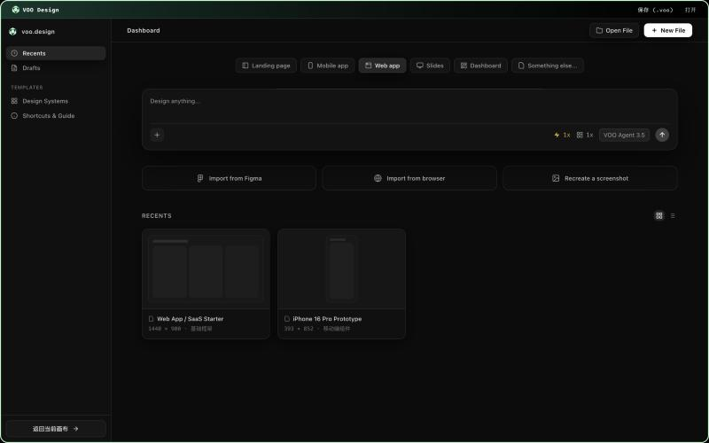
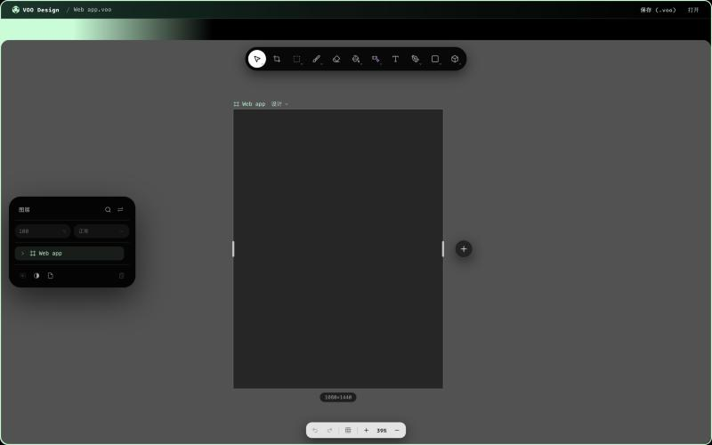

<p align="center">
  
</p>

<h1 align="center">VOO Design</h1>

<p align="center">
  <strong>An agent-driven design editor for the future</strong><br />
  <sub>Design with an AI agent that works directly on the canvas. Vector, pixel and layout editing in one document. Runs on the desktop (Electron) and in the browser.</sub>
</p>

<p align="center">
  
  
  
  
</p>



**VOO Design** is a design editor built around an AI agent. The agent works directly on the document: it reads the layer tree, applies transactional edits, and places generated images on the canvas, while you keep direct control of vector shapes, pixel layers, text, masks and filters in the same file. Local AI tools (background removal, upscaling, inpainting) run on your machine, and local CLI coding agents (Claude Code, Codex, OpenCode, Antigravity) can operate the canvas through a sandboxed tool interface.



---

## Features

### Editing
- **Vector and pixel layers**: rectangles, ellipses, paths drawn with the pen tool, text, images, groups and boolean operations.
- **Selection tools**: marquee, lasso and magnetic lasso, with snapping, equal-gap distribution and alignment.
- **Pixel tools**: brush, eraser, paint and mask editing, with undo and redo. Brush stamps can be imported from Photoshop `.abr` files.
- **Transforms**: free transform, mesh transform and puppet warp.
- **Non-destructive adjustments**: adjustment layers and blend modes.
- **Text on path** and **auto layout**, including layout constraints resolved on import.
- **Find and replace**, a **command palette**, **comments**, and a **history panel** with full undo/redo.

### Output
- **Code export** — turn a document (or a selection) into a standalone HTML page with Tailwind classes, a single React component, or semantic HTML + CSS.
- **Presentation editor** — build slide decks on the canvas and export them to PPTX and PDF.
- **Image export** to PNG, JPG, WebP, SVG, PDF, PSD and a standalone HTML page.

### File formats
- **`.voo`** is the native project format: it holds the document and its image data, and nothing is lost on save.
- **Round-trip saves** to SVG, `.fig` and PSD, with the per-format losses shown before saving.
- **Imports**: `.fig` files (decoded in a streaming worker with progress), PSD, SVG and `.abr` brush stamps.

### Local AI (on-device)
- **Background removal** with an on-device matting model (RMBG-1.4 or a smaller fallback you can pick in settings).
- **Upscaling** with Real-ESRGAN-style compact models.
- **AI repair and inpainting** with a LaMa model.

The models run locally through ONNX Runtime Web. See [AI models](#ai-models) below.

### Collaboration
- Real-time collaborative sessions over WebRTC (presence, rooms, stroke sync).

---

Use the canvas from Claude Code or Codex with the [MCP server](docs/mcp-server.md).

## Getting started

Requires Node.js 20+ and npm.

```bash
git clone https://github.com/umaxzhao/voo-design.git
cd voo-design
npm install
```

Run the web app:

```bash
npm run dev          # http://localhost:5173
```

Run the desktop app against the dev server (starts Vite and Electron together):

```bash
npm run electron:dev
```

Build the web app, or package the desktop app:

```bash
npm run build
npm run electron:build
```

> The `predev`/`prebuild` hooks copy the ONNX Runtime and CanvasKit WASM
> binaries from `node_modules` into `public/`, so they exist for the first dev
> or build run without an extra manual step.

---

## Scripts

| Command | What it does |
| :--- | :--- |
| `npm run dev` | Vite dev server for the web editor (port 5173) |
| `npm run electron:dev` | Vite + Electron together (`concurrently` + `wait-on`) |
| `npm run build` / `npm run preview` | Production web build / serve it |
| `npm run electron:build` | Production build plus `electron-builder --dir` (output in `release/`) |
| `npm test` | Unit tests (vitest, run once) |
| `npm run test:watch` | Unit tests in watch mode |
| `npm run lint:design` | Design-token / visual-language lint over the source tree |
| `npm run bridge` | Start the local CLI bridge (`ws://127.0.0.1:4179`) |

`npm run lint:design` accepts individual paths (`node scripts/check-design.mjs src/foo.jsx`) and a `--staged` flag for staged-content checks. Every finding states the correct replacement, so the linter output itself teaches the design rules — see [docs/contributing.md](docs/contributing.md).

---

## Design agent and local CLI agents

The **agent panel** is a tool-calling chat that can inspect the layer tree and apply transactional canvas mutations (geometry, styling, text, auto layout) with visual focus feedback, undo/redo synchronization, and image generation placed on the canvas. Two ways to power it:

- **A provider model** configured in agent settings (API key, base URL, model, separate text and image models).
- **Local CLI agents installed on your machine** — Claude Code, OpenAI Codex, OpenCode, Antigravity — run in a restricted mode that exposes only VOO's canvas tools. From the desktop app they run directly; from a browser tab they run through the **local CLI bridge**:

```bash
npm run bridge       # ws://127.0.0.1:4179 for the web editor to reach local CLIs
```

Details: [docs/agents.md](docs/agents.md).

---

## Testing

```bash
npm test             # unit tests (vitest)
npm run lint:design  # design-token lint
```

---

## AI models

Model weights are not stored in this repository.

- **Desktop installer**: the installer includes the models that the local AI features need.
- **Web and development builds**: models are downloaded the first time you use a feature, then cached by the browser. They come from the URL in `VITE_MODEL_BASE_URL` (default `https://voo.run/models`).

To serve models from your own host, create a `.env` file:

```bash
VITE_MODEL_BASE_URL=https://your-host.example/models
```

Each model keeps its own license. Check it before you redistribute the model or use it commercially. For example, the background-removal model `rmbg-1.4` is listed under the `bria-rmbg-1.4` license in [`src/canvas/editor/matting_models.js`](src/canvas/editor/matting_models.js).

---

## Architecture overview

The editor is React on top of a document store, rendered through a Skia/CanvasKit WASM scene renderer, with an Electron layer that adds file dialogs, workspace folders and local CLI sessions. The full breakdown lives in [docs/architecture.md](docs/architecture.md).

| Path | Contents |
| :--- | :--- |
| `src/canvas/editor/` | Editor engine, tools, rendering, export and AI pipelines |
| `src/canvas/components/` | React UI: toolbars, panels, layers, dialogs |
| `src/canvas/store/` | Project I/O, save formats, folders, image cache |
| `src/canvas/agent/` | Design agent loop, canvas tools, chat streaming |
| `src/canvas/figma/` | `.fig` reader/writer, Figma-to-VOO import pipeline |
| `src/shared/` | Shared code: i18n, providers, persistence contracts, CLI agent catalog |
| `electron/` | Electron main and preload processes, CLI agent sessions, CLI bridge |
| `design/` | Design tokens and the lint rules behind `npm run lint:design` |
| `vendor/voo-canvas-core/` | Skia scene renderer, included as a local package |
| `tests/unit/` | Unit tests |

---

## Contributing

See [docs/contributing.md](docs/contributing.md) for the development workflow, the design-token gate and how to add canvas tools or persistence contracts.

---

## License

MIT. See [LICENSE](LICENSE).
