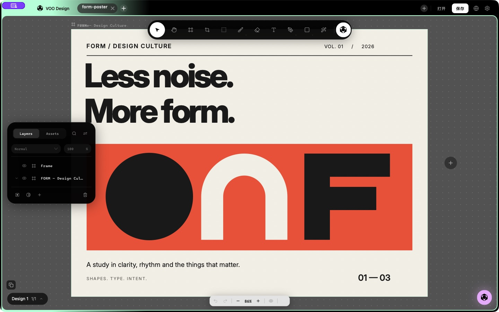
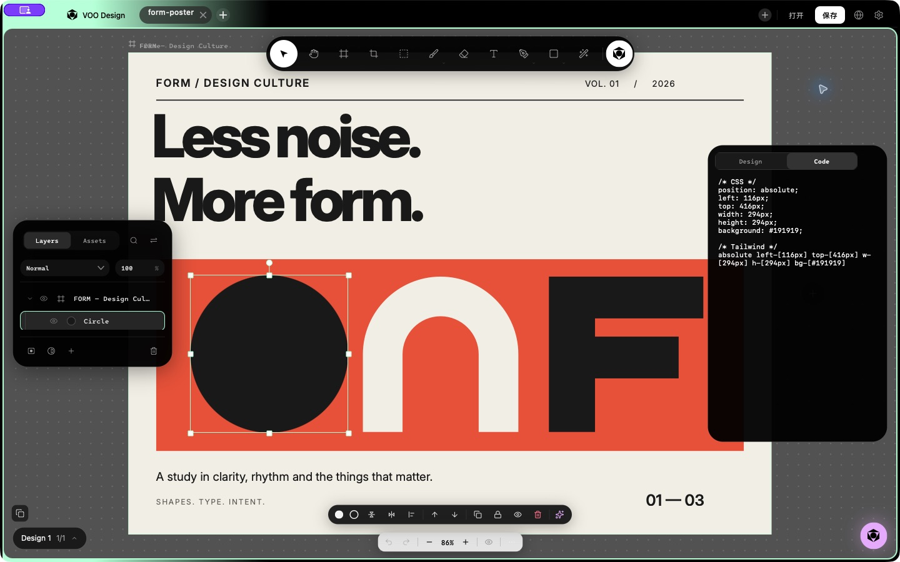
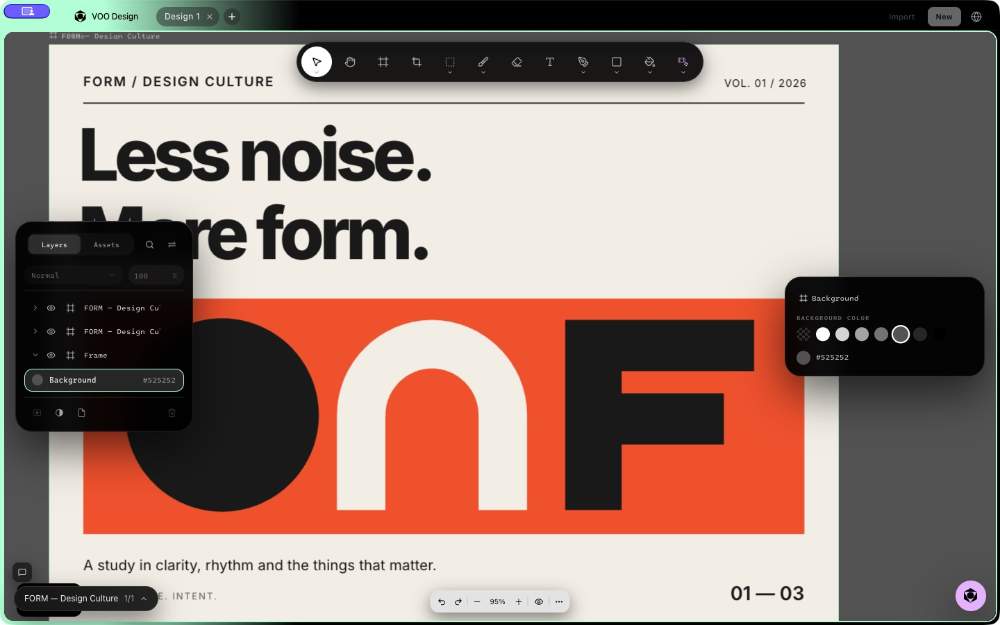
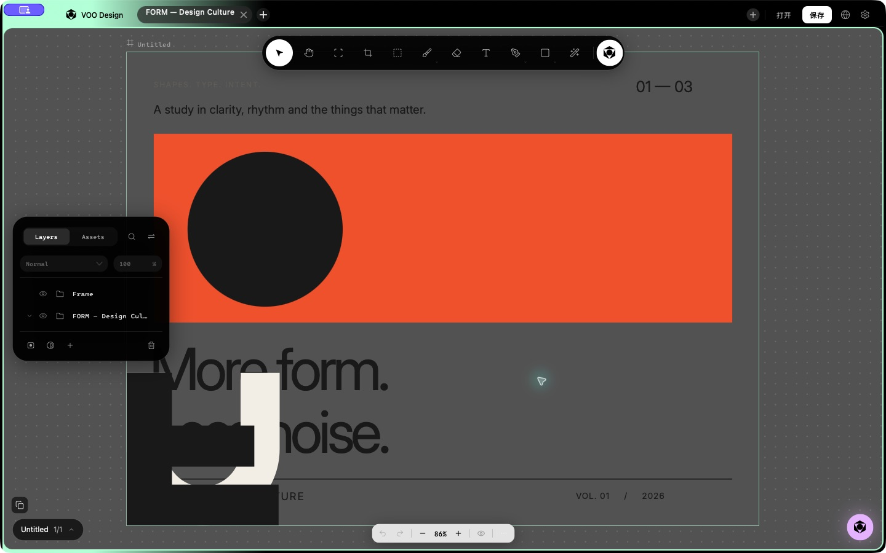

# Electron → 原生版功能与界面差异审计

审查日期：2026-11-01。**判定：未达到 1:1 复刻要求，当前为部分实现。**
首次审查记录 24 项差异：4 项 P0、17 项 P1、3 项 P2。修复及复查结果见下方更新；原始复现保留。
旧版文档中的“核心交互已对齐”“100% 通过”不再作为整体功能结论；历史记录保留在 Git 中。

## 本轮修复与继续复查 — 2026-11-01

整体结论仍为 **部分实现，1:1 验收不通过**。本轮先修数据与主流程，再验证真实 AppKit 界面。
下表的“已修声明范围”仅覆盖列出的行为，不表示整项复杂功能全部完成。

| 差异 | 本轮变化与已登记回归 | 尚未认证的范围 |
| --- | --- | --- |
| D01 | 新建、打开、关闭、退出使用同一未保存确认；取消保留文档及 Undo，保存失败不替换 | 多文档标签、崩溃/磁盘中断、全部草稿恢复组合 |
| D02 | 官方 envelope 与裸 JSON 共用模型；未知字段、页面快照、多 Paint 及未编辑的 Web effects 保留；损坏 nodes 与 x/y/width/height 抛错；主色修改同步主 Paint，保留其他 Paint | 全量 schema、任意大整数、所有已知字段的未知扩展、Web effects 编辑合并、跨版本编辑语义；多 Paint 完整渲染仍缺 |
| D03 | 二进制 assets 接入文档与 imageId/src；JSON 保存后冷读保留图片；HTML 使用真实 src | OS 重启后的全部资源生命周期、复制/撤销/释放与外部图片 |
| D04 | 首页、侧栏、建议、选区入口调用同一 dispatch 操作；注入调度器验证恰好执行一次 | 实际联网生成、失败/取消/重试与付费服务，不能用注入测试认定成功 |
| D05–D08 | 画布与输入采用左上坐标；配套覆盖层、图像和旋转手柄同步；Web Frame 标记/路径局部坐标与手柄/数字字重对齐 | 路径闭合/多子路径、全部裁切、嵌套/旋转/文字编辑/IME/字体替代及导出组合 |
| D09–D11 | 打开颜色面板不再触发旧 target；渐变色标编辑保留渐变；基础形状 PNG 渐变复用画布解析与绘制；HTML image src 与文本转义 | 多 Paint、渐变描边、复杂合成、SVG 与所有图像格式 |
| D12 / D24 | F=Frame、A=Edit nodes；画笔再次进入显示真实大小/透明度/颜色；形状连续绘制并使用浅灰填充/白描边 | Crop、填充工具、AI 修复和完整画笔/橡皮预设等仍未对齐 |
| D14 | 图层搜索保留命中祖先、清空恢复；两端换位入口调用同一操作；Code 显示选区 CSS/Tailwind 并随选区刷新 | 完整 Web 代码面板的复制、效果、组件 Code Connect 与全部视觉细节 |
| D20 | toast 改为屏幕可见状态；协作明确提示尚未接入，取消虚假成功 | Assets 模型、真正协作及链接分享仍缺 |
| D22 | 工具栏按 editor 实际可用宽度缩放；Agent 布局有断言。探针请求 960pt，但实际截图为 1000pt，editor=613pt、工具栏=589pt | 真实 960pt、所有缩放/字体与触屏点击区域、极窄空间收纳仍未认证 |
| D23 | 修正 F/A、连续绘制、旋转手柄测试 oracle；鼠标事件使用真实窗口转换；真实示例缺失现在失败；新增文档/像素/任务/UI 回归 | 仍不是完整功能清单；历史通过不继承到新代码 |
| D13 / D15–D19 / D21 | 未标为完成；页面元数据与透明度显示有基础修复 | 导入、真实登录、多 Paint 编辑、真页面、模型/附件、全局主题/语言、重复眼睛/效果默认态仍需继续 |

复查中新发现并已修：菜单打开文件后仍停留首页；冷启动加载在布局前 fit 导致负偏移；保留多 Paint 后主色修改未同步；渐变导出遗漏实色描边；Code 模式残留 Design 行背景。前四项有状态/像素回归，Code 另加背景透明像素断言，修复前界面与执行失败均保留。
一次中间版本把 Web `strokeDash: "solid"` 当数组严格解码，导致真实示例失败且错误弹窗阻塞测试；该运行已中断，不能算通过。
随后补齐字符串/数组兼容并重跑，不把中间通过结果拼接成最终结果。

默认 Documents 目录启动时曾在 `WorkspaceManager.setupWatcher → open(O_EVTONLY)` 阻塞，采样留存。
界面复查使用 `VOO_USER_DATA_DIR` / `VOO_DOCUMENTS_ROOT` 隔离目录，不认证默认目录权限/监视器上下文。
本轮不覆盖原工作区未提交内容，不部署该分支夹带的其他 Web 改动。原生交付使用本地 `.app`。

最终应用源码：[`d5720aa`](https://github.com/umaxzhao/voo-design/commit/d5720aac5669970c2b311def4e9f6cb8ac6c38dc)。
[完整机器记录及指纹](../docs/audits/native-parity/repair/verification.json)：同源码 **412/412** 集成检查（`-Onone`）、模块规划 **11/11**、登记检查通过；生产构建（`-Osize`）及 ad-hoc 签名通过，二进制 **5,082,720 bytes**。
新增 Swift 文件严格 lint 通过；差分规则/消息数量未增加。旧文件全量 lint 仍失败（3,163 条诊断，基线 3,346），不记为全量通过。
优化测试的中间运行曾因渐变描边断言失败（410/411）；[原始失败](../docs/audits/native-parity/repair/gradient-stroke-before.txt) 保留。最终集成检查未宣称为优化测试运行，生产构建与真实 App 操作另列。

| 最终 FORM（86%） | 最终 Code（已清理背景） |
| --- | --- |
|  |  |

最终真实 App 复看：冷启动打开正确居中、搜索、Code、画笔弹层、新建确认/取消及 Undo 保留均有 AX/截图证据。
临时复制已撤销，仓库示例未改。[未保存确认](../docs/audits/native-parity/repair/unsaved-final.png) · [画笔](../docs/audits/native-parity/repair/brush-final.png)。
早期引擎像素探针与换位截图对应 `b740009`，单独标记，不继承为最终渲染全量通过。

检查解释：集成模式编译生产 `Sources/`（排除应用入口 Main），并保留旧测试的参考支持类型。
412 是已登记检查数，包含模型、AppKit 与参考支持断言；并非 412 条完整用户端到端流程。
新增文档/任务/面板/像素检查使用生产实现，实际窗口截图另列，不将两者合并成全量功能覆盖。

## 审查基线与证据边界

- 源码、生产构建与诊断程序基线：`392f45f147e9b33ba5a749d9b69081e2b4cd2b77`。
  包含本地最新原生改动 `7b95346` 与上轮浮动工具条定位修复 `b464b8f`。
- 实际 UI 走查使用当时已运行的原工作区原生应用与 Electron 应用。
  Electron 的 Vite 服务读取原工作区的未提交代码。它是现场参照，不能称为干净发布基线。
  原生现场可执行文件的 SHA256 已保存；没有独立证明该二进制对应某个精确源码提交。
- 原生源码诊断另在干净工作区编译执行，与现场 UI 证据分开标注。
- 1440×900 现场界面，以及 960×600、Agent 开启的生产 AppKit 布局诊断。
  Electron 的 FORM 示例为 95% 缩放，原生为 86%；截图可证明布局语义差异，不能用于精确像素差分。
- 未调用付费生成、未登录账户、未覆盖用户项目文件。Electron 临时绘制已撤销，原生测试需求已清除。
- [机器记录与证据指纹](../docs/audits/native-parity/audit-summary.json)。
  `execution` 表示执行结果，`coverage` 与 `verdict` 表示复刻验收范围和结论，两者不可混用。

## 同一文档的实际差异

| Electron：FORM 原稿 | 原生版：打开同一示例 |
| --- | --- |
|  |  |

Electron 的标题在顶部，图形位于下方橙色区域，画板为米白色。
原生版文字上下位置颠倒、画板变灰、标题变细、路径图形跑到左下方。
这些是文档解释和绘制错误，不能通过调整窗口间距或圆角修复。

## P0：优先保护数据与打通主任务

### D01 — 新建直接丢弃未保存文档

- 模块：`documents` / `workspace`。证据：实际点击与源码。
- 复现：创建矩形 → 修改渐变 → 点击标题栏 `+`。旧矩形消失，仅剩新 Frame；Undo 同时禁用。
  没有保存提示，也没有保留旧文档的第二个标签。
- 原因：[WindowController.swift](https://github.com/umaxzhao/voo-design/blob/392f45f147e9b33ba5a749d9b69081e2b4cd2b77/native_studio/Sources/UI/WindowController.swift#L855) 的新建入口直接调用
  `newDocument`；该操作替换 document 并清空 commandManager。
- 影响：误点新建就可能失去尚未保存的工作；“多文档 Tab”尚不成立。
- [新建前](../docs/audits/native-parity/native-gradient.png) ·
  [新建后](../docs/audits/native-parity/native-new-discards.png)。
- 修复验收：新建/打开/切换均经同一文档生命周期操作，保留旧文档或明确处理未保存状态；覆盖恢复与撤销边界。

### D02 — `.voo` 读取与再次保存存在静默语义丢失

- 模块：`documents` / `layout` / `layers`。证据：生产模型读写诊断。
- 四份真实示例节点数量均保留，但 `pages` 不再保存，Frame 标记和多 Paint 结构不再保留。
  FORM 的 `clipContent`、`fills`、`strokes`、文字 `paragraphSpacing` 也被丢弃。
  `width/height` 移入 `canvas` 属于 schema 变化，不单独视为信息丢失。
- 将真实 FORM 二进制头中的官方 JSON envelope 写成 JSON 后读取：14 节点变为 0，
  1200×900 变为默认 1200×800，无错误返回。损坏的 `nodes` 字段同样被吞错成空文档。
- 原因：[DocumentModel.swift](https://github.com/umaxzhao/voo-design/blob/392f45f147e9b33ba5a749d9b69081e2b4cd2b77/native_studio/Sources/Models/DocumentModel.swift#L1211) 只解顶层裸 document，
  读写字段不包含页面/布局等语义；`try? … ?? []` 抹平失败。
- [四示例统计](../docs/audits/native-parity/example-summary.json) ·
  [FORM 往返字段](../docs/audits/native-parity/roundtrip-findings.json) ·
  [官方 JSON 输入](../docs/audits/native-parity/form-official-json-envelope.json) ·
  [错误的空文档输出](../docs/audits/native-parity/form-official-json-envelope-out.json)。
- 修复验收：官方 JSON/二进制共用完整 schema，未知字段保留或明确报损失；多页、多 Paint、约束、资源均做冷重开往返。

### D03 — 二进制资源解出后未交给文档与渲染器

- 模块：`documents` / `images`。证据：生产 DocumentIO、容器与导出器联合诊断。
- 生成含红色 PNG 和 `imageId` 的合法二进制：容器解出 1 个资源，
  `DocumentIO.loadDocument` 只返回 document，图片 `src` 为空。
  原应为红色的采样像素实际为白色 `[1,1,1,1]`。
- 原因：[DocumentIO.swift](https://github.com/umaxzhao/voo-design/blob/392f45f147e9b33ba5a749d9b69081e2b4cd2b77/native_studio/Sources/Engine/DocumentIO.swift#L85) 丢弃解码结果的 assets；
  [ExportEngine.swift](https://github.com/umaxzhao/voo-design/blob/392f45f147e9b33ba5a749d9b69081e2b4cd2b77/native_studio/Sources/Engine/ExportEngine.swift#L392) 图片绘制要求 `src`。
- [诊断结果](../docs/audits/native-parity/engine-findings.json) ·
  [丢图后的实际输出](../docs/audits/native-parity/binary-image-render.png)。
- 修复验收：资源表真正接入渲染、保存、复制、导出和关闭清理，使用跨重启的含图项目验证。

### D04 — 首页需求提交没有启动生成

- 模块：`platform` / `workspace`。证据：现场提交与源码。
- 复现：首页输入 `Create a blue rectangle named PARITY_AUDIT` → 发送。
  只出现空画布和固定回复“正在…准备工作区”，没有蓝色矩形，也没有执行中的任务。
- 原因：[WindowController.swift](https://github.com/umaxzhao/voo-design/blob/392f45f147e9b33ba5a749d9b69081e2b4cd2b77/native_studio/Sources/UI/WindowController.swift#L127) 的 `onPromptSubmit`
  只新建文档并追加两条消息，没有调用后面的 `handleAgentPrompt`。
- [提交结果](../docs/audits/native-parity/native-home-prompt.png)。
- 修复验收：首页、侧栏、选区 AI 共用同一真实任务操作；覆盖成功、失败、取消、重试和回到首页。

## P1：主要功能、绘制与交互不等价

| ID / 模块 | 已核实差异、影响与证据 | 修复验收方向 |
| --- | --- | --- |
| **D05 / canvas** | 原生画布沿 AppKit 向上的 y 轴直接绘制 Web 向下的文档坐标。同一 FORM 内容上下颠倒；`CanvasStageView.draw` 只做正向 zoom，而导出器又独立翻转 y。见同文档截图与 [CanvasStageView.swift](https://github.com/umaxzhao/voo-design/blob/392f45f147e9b33ba5a749d9b69081e2b4cd2b77/native_studio/Sources/Canvas/CanvasStageView.swift#L1091)、[ExportEngine.swift](https://github.com/umaxzhao/voo-design/blob/392f45f147e9b33ba5a749d9b69081e2b4cd2b77/native_studio/Sources/Engine/ExportEngine.swift#L267)。 | 统一文档/屏幕/输入/导出坐标契约，验证点击、拖动、文本、路径、导出和保存一致。 |
| **D06 / layers / compositing** | Web Frame 可以是 `kind: group, isFrame: true`。原生不读 `isFrame`，将其视为不绘制填充的普通 Group，导致 FORM 米白底丢失。四示例分别有 7/2/73/2 个此类节点。见 [示例统计](../docs/audits/native-parity/example-summary.json)、[DocumentModel.swift](https://github.com/umaxzhao/voo-design/blob/392f45f147e9b33ba5a749d9b69081e2b4cd2b77/native_studio/Sources/Models/DocumentModel.swift#L1033)、[CanvasStageView.swift](https://github.com/umaxzhao/voo-design/blob/392f45f147e9b33ba5a749d9b69081e2b4cd2b77/native_studio/Sources/Canvas/CanvasStageView.swift#L1757)。 | 保留容器类型、填充、裁切、父子坐标与层级；验证嵌套和分组转换。 |
| **D07 / vectors** | Web 路径锚点是节点局部坐标，原生 shapePath 直接拿 points 画世界路径，没有应用 node.x/y。FORM 的拱形和 F 跑到左下方。见 [CanvasStageView.swift](https://github.com/umaxzhao/voo-design/blob/392f45f147e9b33ba5a749d9b69081e2b4cd2b77/native_studio/Sources/Canvas/CanvasStageView.swift#L1447)；Web 定义在 `scene_model_paths.js`。 | 路径局部坐标、手柄、移动、缩放、旋转和 SVG/PNG 输出统一变换。 |
| **D08 / text** | `nsWeight` 只识别 bold/medium 等名称，不识别 600/700/800；实际诊断确认 `800 == regular`。FORM 标题从粗体变细体；四示例分别有 45/4/40/16 个数字字重文本节点。见 [TextStyle.swift](https://github.com/umaxzhao/voo-design/blob/392f45f147e9b33ba5a749d9b69081e2b4cd2b77/native_studio/Sources/Engine/TextStyle.swift#L36) 与 [诊断](../docs/audits/native-parity/engine-findings.json)。 | 完整数字/命名字重映射，注册实际字体；测量文字包围框、换行与导出，不只检查 fontWeight 字段。 |
| **D09 / inspector** | 在原生创建线性渐变后，仅点击其颜色 swatch，填充类型就变成 Solid，图形变黑；尚未选择新颜色便已修改作品。`presentColorPanel` 先安装 action 再设 panel.color，回调把 fill 当纯色提交。见 [渐变前](../docs/audits/native-parity/native-gradient.png)、[点击后](../docs/audits/native-parity/native-after-picker.png)、[PropertiesPanelView.swift](https://github.com/umaxzhao/voo-design/blob/392f45f147e9b33ba5a749d9b69081e2b4cd2b77/native_studio/Sources/UI/PropertiesPanelView.swift#L3827)。 | 打开编辑器零修改；预览、提交、取消独立，保留完整渐变和一次撤销语义。 |
| **D10 / compositing** | 同一合法 CSS 线性渐变，生产 stage 中点 RGB ≈ 0.5066，PNG 导出中点为 0。导出器按 NSColor(hex:) 处理 gradient，退回黑色。见 [stage](../docs/audits/native-parity/gradient-stage.png)、[导出](../docs/audits/native-parity/gradient-export.png)、[诊断](../docs/audits/native-parity/engine-findings.json)。 | 画布、PNG/PDF/SVG 使用一致 Paint 解释；比较实际像素。诊断 stage 已隐藏子视图 chrome，避免采样工具条。 |
| **D11 / documents** | HTML 格式已存在，但 image 分支读 node.text，不读 node.src。以有效 data URL 导出得到 `src=""`。见 [ExportEngine.swift](https://github.com/umaxzhao/voo-design/blob/392f45f147e9b33ba5a749d9b69081e2b4cd2b77/native_studio/Sources/Engine/ExportEngine.swift#L231)、[诊断](../docs/audits/native-parity/engine-findings.json)。不能再将 HTML 简单标成“缺失”或“完成”。 | 实际打开导出的 HTML，验证图片、路径、字体、资源及视觉结果。 |
| **D12 / inspector / selection** | 工具语义接错：标记 Frame/Crop/F 的 `.node` 实际执行节点编辑/选择移动；现场拖拽移动了原 Frame，未创建新 Frame。画笔二级菜单却显示“矩形选区/套索”；工具轨没有与 Electron 对应的 Fill/AI Repair 功能入口，而是 Wand/助手。见 [Frame 操作](../docs/audits/native-parity/native-frame-tool.png)、[画笔菜单](../docs/audits/native-parity/native-brush-options.png)、[ToolRail.swift](https://github.com/umaxzhao/voo-design/blob/392f45f147e9b33ba5a749d9b69081e2b4cd2b77/native_studio/Sources/UI/ToolRail.swift#L831)。 | 按每个工具的业务操作对齐入口、快捷键、子工具、光标、参数和取消语义，不能只比较 activeTool 枚举。 |
| **D13 / workspace** | Figma、Browser、Screenshot 三个首页导入卡片都只弹说明框。Browser 标题栏也只有日志/提示回调；Figma 提示可打开 .fig，但 DocumentIO 没有 .fig 转换分支。见 [Figma](../docs/audits/native-parity/native-figma-import.png)、[Browser](../docs/audits/native-parity/native-browser-import.png)、[截图](../docs/audits/native-parity/native-screenshot-import.png)、[WindowController.swift](https://github.com/umaxzhao/voo-design/blob/392f45f147e9b33ba5a749d9b69081e2b4cd2b77/native_studio/Sources/UI/WindowController.swift#L137)。 | 分别走真实来源→解析/附件→文档/生成流程，具有加载、错误、取消和重试反馈。 |
| **D14 / inspector / layers** | 点击图层 Search 没有输入框；Search/Sort 回调没有 host 接线。Code 标签只改变选中态，仍显示 Transform/Fill，headerTabs 无切换内容处理。见 [搜索](../docs/audits/native-parity/native-layer-search.png)、[Code](../docs/audits/native-parity/native-code-tab.png)、[LayersPanel.swift](https://github.com/umaxzhao/voo-design/blob/392f45f147e9b33ba5a749d9b69081e2b4cd2b77/native_studio/Sources/UI/LayersPanel.swift#L1400)、[PropertiesPanelView.swift](https://github.com/umaxzhao/voo-design/blob/392f45f147e9b33ba5a749d9b69081e2b4cd2b77/native_studio/Sources/UI/PropertiesPanelView.swift#L2725)。 | 每个可见入口都产生对应可操作结果，覆盖关闭、空结果、键盘与选择切换。 |
| **D15 / platform / inspector** | General 内 Email、Password、Sign In 只是自绘占位；AX 只有 Your name，ControlID/activate 没有登录操作。看起来能登录，实际输入和按钮都不可用。见 [设置截图](../docs/audits/native-parity/native-settings.png)、[SettingsDrawerView.swift](https://github.com/umaxzhao/voo-design/blob/392f45f147e9b33ba5a749d9b69081e2b4cd2b77/native_studio/Sources/UI/SettingsDrawerView.swift#L2337)。未测试任何真实登录服务，也不声称 Electron 认证服务已验收。 | 真实控件与真实流程，或明确呈现不可用状态；不要绘制可操作外观却无控件。 |
| **D16 / inspector** | Paint 模型只有单 fill，Add Fill 被隐藏；Fill/Stroke Hex 与百分比是只读标签，百分比写死 `100 %`，不能反映每层 paint alpha。无法对齐 Electron 多填充/多描边、独立 alpha、Image/Texture 编辑。见 [PropertiesPanelView.swift](https://github.com/umaxzhao/voo-design/blob/392f45f147e9b33ba5a749d9b69081e2b4cd2b77/native_studio/Sources/UI/PropertiesPanelView.swift#L3371) 与 Electron `fill_paint_row.jsx`。 | 先补齐 Paint 模型，再共享编辑操作；单选/混合值/显隐/排序/移除/Undo 全链路验证。 |
| **D17 / workspace / layers** | 页码菜单把所有 `.frame` 当成页面，“新建页面”只在同一场景旁边放一个 Frame，并非 Web pages 的独立 sceneDoc。嵌套 Frame 也会混进页数。见 [WindowController.swift](https://github.com/umaxzhao/voo-design/blob/392f45f147e9b33ba5a749d9b69081e2b4cd2b77/native_studio/Sources/UI/WindowController.swift#L3432)。该项为源码核实，未进行多页现场切换。 | 真正的页面身份与场景生命周期，分开 Page/Frame，验证命名、切换、排序、保存和资源共享。 |
| **D18 / platform** | Agent 模型胶囊只是 drawModelChip，mouseDown 仅聚焦输入框，没有模型选择；模型名称由 Provider→固定字符串映射。composer 没有 Electron 的附件/上下文等价入口。见 [AgentPanelView.swift](https://github.com/umaxzhao/voo-design/blob/392f45f147e9b33ba5a749d9b69081e2b4cd2b77/native_studio/Sources/UI/AgentPanelView.swift#L884)、[WindowController.swift](https://github.com/umaxzhao/voo-design/blob/392f45f147e9b33ba5a749d9b69081e2b4cd2b77/native_studio/Sources/UI/WindowController.swift#L3173) 和首页提交截图。 | 实际模型发现/选择/配置与本次请求一致，附件真实传递；无账号/网络时有明确状态。 |
| **D19 / inspector** | 浅色切换仅设置窗口/外壳色并触发重绘，面板 palette 仍是固定黑底白字；语言变更回调没有接到全应用，现场中文标题栏、英文面板、中文工具菜单混用。主题与语言的链路缺口来自源码；本轮未修改用户偏好进行动态切换验收。见 [WindowController.swift](https://github.com/umaxzhao/voo-design/blob/392f45f147e9b33ba5a749d9b69081e2b4cd2b77/native_studio/Sources/UI/WindowController.swift#L3413)、[Theme.swift](Sources/UI/Theme.swift)、[SettingsDrawerView.swift](https://github.com/umaxzhao/voo-design/blob/392f45f147e9b33ba5a749d9b69081e2b4cd2b77/native_studio/Sources/UI/SettingsDrawerView.swift#L1181)。 | 统一语义 token 与本地化源，完整切换并重启，覆盖菜单/弹层/画布 UI/Agent。 |
| **D20 / platform** | `showChromeToast` 只有 beep + NSLog，没有屏幕反馈；协作按钮也仅调用它，甚至写“已生成分享链接”，没有实际链接操作。Assets tab 永远是 `No assets yet`，无资源模型。见 [WindowController.swift](https://github.com/umaxzhao/voo-design/blob/392f45f147e9b33ba5a749d9b69081e2b4cd2b77/native_studio/Sources/UI/WindowController.swift#L185)、[showChromeToast](https://github.com/umaxzhao/voo-design/blob/392f45f147e9b33ba5a749d9b69081e2b4cd2b77/native_studio/Sources/UI/WindowController.swift#L3427)、[LayersPanel.swift](https://github.com/umaxzhao/voo-design/blob/392f45f147e9b33ba5a749d9b69081e2b4cd2b77/native_studio/Sources/UI/LayersPanel.swift#L1295)。 | 操作结果真实可见；只在真正完成后显示成功，补齐资源/协作流程或明确未实现。 |
| **D23 / 验收体系** | 397/397 仍全绿，而上述问题真实存在。`CanvasInteractionTests` 还明确断言 F→`.node`，把错误工具映射固定成通过；真实示例测试只验证节点数/尺寸，缺文件时 continue/return 也算通过。旧 README/TEST_READY 将这一结果扩展成整体 1:1。见 [CanvasInteractionTests.swift](https://github.com/umaxzhao/voo-design/blob/392f45f147e9b33ba5a749d9b69081e2b4cd2b77/native_studio/tests/CanvasInteractionTests.swift#L39)、[InspectorBehaviourTests.swift](https://github.com/umaxzhao/voo-design/blob/392f45f147e9b33ba5a749d9b69081e2b4cd2b77/native_studio/tests/InspectorBehaviourTests.swift#L398)。 | 以 Electron 操作的输入/文档状态/像素/历史/往返为 oracle；缺 fixture 必须报错或明确 skip，不能假通过。 |

## P2：界面细节与操作一致性

| ID | 已核实差异与证据 | 验收方向 |
| --- | --- | --- |
| **D21 / inspector** | 原生默认铺开全部 Gaussian Blur/Drop Shadow/Inner Shadow 控件；Electron 使用 Add Effect。原生 Fill 一行出现两个眼睛，反复入口增加负担；标题与正文混用 system/mono，细小字段和标签易截断；Prototype、翻转等同类入口也未对齐。见 [Electron Inspector](../docs/audits/native-parity/electron-inspector.png) 与 [Native Inspector](../docs/audits/native-parity/native-inspector.png)。 | 按当前 Electron 默认态与展开态对齐控件、顺序、字号、字重、图标、间距、hover/focus；高级选项使用单一入口。 |
| **D22 / inspector** | 在应用允许的 960×600 窗口开启 Agent，editor 仅 576pt，工具轨仍为 589pt，x=-6，左右被裁切。固定 364pt Agent 没有相应收纳策略。见 [960×600](../docs/audits/native-parity/native-narrow-agent.png) 与 [测量](../docs/audits/native-parity/engine-findings.json)。 | 按实际 editor 宽度适配，覆盖 Agent 开关、侧栏展开、最小/中间/大窗口。 |
| **D24 / 连续创建** | 同类矩形操作：Electron 默认灰填充/白描边，绘制后保留 Shapes；原生默认黑色且自动回到 Select。默认黑色放在深色画板上也难以辨认。见两版 Inspector 截图和 `native-rectangle-created` 的现场记录。 | 对齐创建默认样式、连续绘制、工具记忆、Shift/Option、Escape，以及一次 Undo 的边界。 |

## 模块状态与尚未验收场景

这里的“执行通过”仅指对应测试断言，不表示模块功能对齐。

| 模块 | 本轮直接证据 | 当前状态 / 剩余 |
| --- | --- | --- |
| workspace | 首页提交、三类导入、同文档打开 | 失败/部分：主流程阻断；真实模板、目录权限、Trash 恢复未走查 |
| documents | 四示例往返、JSON envelope、二进制资源、HTML | 失败：存在静默丢失；全部格式/多文档/冷重开矩阵未完成 |
| canvas | FORM 实际渲染、创建/拖动、stage/PNG 像素 | 失败：坐标与导出不一致；标尺/网格/触控板组合未完成 |
| selection | 矩形创建、Frame 工具拖动、浮动条现场 | 部分：工具语义不等价；嵌套/锁定/多选/取消全组合未完成 |
| layers | 搜索、Assets、group/isFrame 模型 | 失败/部分：入口与容器语义缺口；大型树/拖排序/蒙版链未完成 |
| compositing | 渐变 stage/PNG、图片资源 | 失败：像素不一致；所有混合/蒙版/效果组合未完成 |
| vectors | FORM 两个路径实际位置 | 失败/部分：路径坐标错误；布尔/描边/导出全组合未完成 |
| text | 数字字重生产解析、FORM 标题 | 失败/部分：字重错误；富文本、IME、自动尺寸/路径文字未完成 |
| images | 合法二进制图片及 HTML 导出 | 失败/部分：资源丢失；真实 AI、编解码、裁切/像素选择未完成 |
| layout | 往返字段、页面与 Frame 源码 | 部分：尚无 Auto Layout/组件/变量的交互等价证据 |
| inspector | Paint、Code、工具菜单、默认面板、960pt | 失败/部分：明显操作与细节差异；全字段 commit/cancel/混合值未完成 |
| platform | 首页 Agent、模型胶囊、设置 AX、协作回调 | 失败/部分：入口未接通；真实服务、重连、签名安装包未完成 |

## 执行记录与已存在能力

- 干净源码基线的集成测试：**397/397**，日志 `/tmp/voo-native-parity-audit/full-tests.log`。
  这些是已登记断言的通过结果，**整体复刻验收仍失败**。
- 生产构建及 ad-hoc codesign 通过：可执行文件 5,216,704 bytes，bundle 10,544 KB。
  构建日志 `/tmp/voo-native-audit-build.log`。这不是分发签名/安装包验收。
- 模块登记检查通过。原生当前确实具备矩形拖绘、基础撤销、部分渐变编辑、形状二级菜单，
  本轮实际操作中这些路径有结果。不能沿用旧审计“渐变/画笔/HTML 全部缺失”的说法。
- AppKit 自绘不等于原生交互完善：AX 中有真实标签的控件应保留，
  但自绘弹层只有 popover 而无选项子元素，登录外观没有输入控件，需专门补键盘/VoiceOver 验收。
- 性能只验证构建体积与本次诊断执行；未做 FPS、大场景滚动、内存压力，未给综合健康分。
  本项目是 macOS AppKit，不套用 iOS/Android 手机控件尺寸评分。

## 可复现诊断材料

- [模型诊断源码](../docs/audits/native-parity/model-probe.swift.txt)：
  使用生产 `DocumentModel.swift` + `Serialization.swift` 编译，输入文件→输出 JSON；不访问服务。
- [引擎诊断源码](../docs/audits/native-parity/engine-probe.swift.txt)：
  使用 `Sources` 下除 `Main.swift` 外的生产源编译；自建红色 PNG、渐变与临时窗口。
  执行时设置独立 `VOO_USER_DATA_DIR`、`VOO_DRAFT_DIR`、`VOO_FONT_DIR`。
- [解码健壮性探针](../docs/audits/native-parity/decode-probes.json) 中 `object-gradient`
  是**畸形输入测试**，不是当前 Electron 的规范渐变 schema；不将其算作渐变兼容失败。
  规范渐变失败证据来自真实 CSS gradient 的 stage/PNG 比较。
- 全部纳入仓库的图片/JSON/探针文本及 SHA256 见 `audit-summary.json`；现场交互通过 CUA，
  外部探针通过生产 API。未把 API 调用冒充实际鼠标/键盘操作。

## 修复顺序

1. **P0 / `$impeccable harden`**：保护未保存文档、完成 schema/资源往返、接通首页真实任务。
2. **P1 / `$impeccable harden`**：统一文档坐标、容器和路径语义、数字字重、Paint/导出渲染。
3. **P1 / `$impeccable harden`**：逐个替换空入口/假控件，接通工具、页面、模型、导入、Code、搜索。
4. **P2 / `$impeccable adapt`**：按实际可用宽度收纳面板，完成最小窗口与 Agent 组合。
5. **P2 / `$impeccable polish`**：在功能已验收的基础上逐态对齐字体、图标、间距、默认值与交互反馈。

每项修复须先保留本报告的失败场景为回归，再记录精确 revision、输入、文档状态、
可见结果、Undo/Redo 和保存重开。未执行的上下文继续标记未验证，不用总测试数替代。
